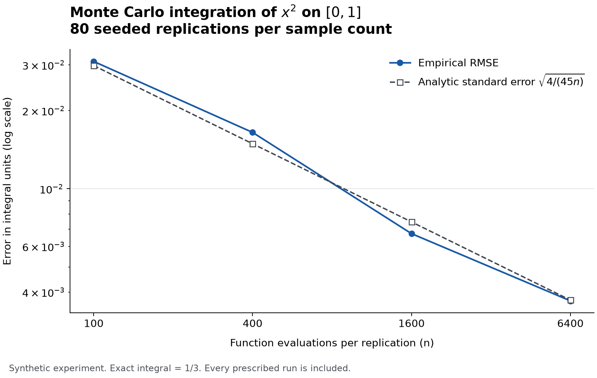

# QuantChapter Monte Carlo Lab

Estimate a definite integral by sampling, then inspect how much uncertainty
remains. This small Python package connects the mathematics to executable,
tested examples from **QuantChapter**, a quantitative education project.

The calculation core has **no runtime dependencies**. It supports Python
**3.11–3.14**, works offline, uses a private seeded random stream, and reports
the sample-based standard error alongside an approximate confidence interval.
This is an initial educational release, not a validated scientific service or
a claim of certified reliability.

## Start in a few minutes

Clone the repository and install it in an isolated environment:

```bash
git clone https://github.com/QuantChapter/quantchapter-monte-carlo-lab.git
cd quantchapter-monte-carlo-lab
python -m venv .venv
# macOS / Linux
source .venv/bin/activate
# Windows PowerShell instead: .venv\Scripts\Activate.ps1
python -m pip install .
quantchapter-monte-carlo square --lower 0 --upper 1 --samples 10000 --seed 2026
```

The exact integral of $x^2$ from zero to one is $1/3$. Your JSON result includes
an estimate, standard error, interval endpoints, seed, sample count, bounds,
package version, and the interval convention. The result should be interpreted
against that known reference; a particular interval is allowed to miss it.

```python
from quantchapter_monte_carlo import integrate

result = integrate(lambda x: x * x, 0.0, 1.0, samples=10_000, seed=2026)
print(result.estimate)
print(result.standard_error)
print(result.confidence_low, result.confidence_high)
```

For an output file, append `--output artifacts/square.json`. Parent directories
are created as needed. An existing file is never replaced, including a racing
writer; choose a new destination. File publication requires a filesystem with
hard-link support. The CLI offers only `square` and `sine`; it never evaluates
expressions or loads user-supplied code.

## Learn what the numbers mean

Begin with the [worked derivation](docs/method.md), then open the
[executed notebook](notebooks/01-integration-and-uncertainty.ipynb). It develops
the estimator, checks a constant function, explains the $n-1$ variance divisor,
and measures convergence across every prescribed replication.



The figure compares empirical root mean squared error with the analytic
$1/\sqrt{n}$ rate for integrating $x^2$ on $[0,1]$. It uses 80 distinct seeded
replications at each of four sample sizes. The JSON source and generating
program sit next to the figure. A single simulation path need not improve
monotonically as samples increase.

Install optional examples and reproduce the committed outputs:

```bash
python -m pip install ".[plot]"
python examples/convergence.py
```

For the locked development environment, install [uv](https://docs.astral.sh/uv/)
and run:

```bash
uv sync --locked --all-extras --dev
uv run --frozen python tools/verify_notebooks.py
```

## Scope and assumptions

- `integrate` accepts a bounded, integrable scalar function and finite increasing
  bounds. It checks sampled outputs, not behavior at every point.
- Samples model independent uniform draws. The implementation uses Python's
  pseudorandom `Random(seed)`, not a source of cryptographic randomness.
- The standard error estimates sampling uncertainty. The normal/CLT interval
  is approximate and has no guaranteed finite-sample coverage. A zero observed
  error does not establish a constant function or exact integration.
- Results use binary floating point. Nonfinite outputs and unrepresentable
  final results fail explicitly. Extreme scales may lose information.
- Repeating the seed reproduces a run in a fixed Python environment. Bitwise
  identity across Python versions or platforms is not promised.
- The library executes the callable you supply with your Python process's
  privileges. It is not a sandbox for untrusted programs.

Per call, samples range from 2 to 1,000,000. Convergence experiments use at least
two replications and cap their total at 10,000,000 evaluations. This package
does not implement adaptive quadrature, importance sampling, quasi-Monte Carlo,
financial pricing, or performance benchmarking. See the [API contract](docs/api.md)
and [JSON schema notes](docs/report-format.md).

## Engineering and contributions

The repository includes strict typing, property tests, independently calculated
reference cases, branch-coverage checks, a locked development environment,
executed-notebook checks, installed-wheel tests, and CI configurations for the
supported Python versions on Linux, Windows, and macOS. Configuration is not
evidence that every remote job has already passed; release evidence belongs in
the actual workflow runs and [verification record](docs/verification.md).

Read [CONTRIBUTING.md](CONTRIBUTING.md), [SECURITY.md](SECURITY.md), and
[CHANGELOG.md](CHANGELOG.md). Original code, documentation, synthetic experiment
outputs, and notebook material are available under the [MIT license](LICENSE).
Third-party dependencies retain their own licenses. General contact:
[support@quantchapter.com](mailto:support@quantchapter.com).
